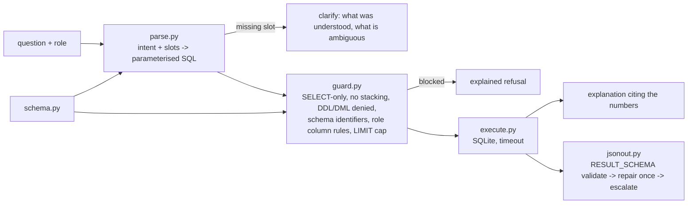

# Jagadish-text2sql-data-agent

[](https://github.com/jagadishmazure-jpg/Jagadish-text2sql-data-agent/actions/workflows/ci.yml)
[](https://github.com/jagadishmazure-jpg/Jagadish-text2sql-data-agent/actions/workflows/codeql.yml)


**Natural language to SQL that is safe to point at a real database: schema grounding, parameterised templates, a read-only guard with role-based PII rules, and answers that cite the numbers.**

> Personal learning and portfolio project. Everything runs offline on synthetic,
> fictional data with no API keys. Nothing is deployed. Numbers in this README
> come from real runs and are re-checked by CI (`scripts/render_docs.py --check`).

## Recruiter summary

- Tackles the hard parts of text-to-SQL: hallucinated columns, destructive or unbounded queries, PII exposure and unexplained answers.
- Real run: 15-question gold set at 1.00 parse and 1.00 execution accuracy (results compared row by row with hand-written SQL); DROP, stacked statements, PII columns and unknown tables all blocked.
- JSON output mode: every answer validated against one declared schema (extra keys, NaN and wrong types rejected), one repair attempt, then a loud escalation that withholds the raw output; repair and escalation rates are counted.
- Deterministic, offline, SQLite; CI with lint, CodeQL, gitleaks and a documented-output drift check.

## Purpose

Language models are fluent with prose and unreliable with rows and columns. This
repo shows the engineering around a text-to-SQL agent for a fictional retailer:
what the generator is allowed to reference, what the database is allowed to run,
who may see which columns, and how an answer explains itself. The generator here
is template-based so the guard and evaluation can be studied without a model.

## Architecture



## How it works

- **Schema grounding** (`text2sql/schema.py`): tables and columns are declared
  once; the parser may only use them and the guard re-checks every identifier.
- **Template parsing** (`text2sql/parse.py`): aggregations, filters, joins and
  top-N questions map to parameterised SQL. User values are always bound
  parameters, never string-interpolated.
- **Guard** (`text2sql/guard.py`): a single SELECT only; `;`-stacked statements and
  16 DDL/DML keywords rejected; unknown identifiers rejected; a role column
  allowlist (`analyst` cannot read email or phone, `viewer` also cannot read
  names); a `LIMIT 1000` cap injected when missing.
- **Execution** (`text2sql/execute.py`): SQLite with a 5-second timeout via a
  progress handler.
- **Evaluation** (`text2sql/eval.py`): each gold question has hand-written
  reference SQL; generated SQL must contain expected fragments and return the
  same rows.

- **JSON output mode** (`text2sql/jsonout.py`): `answer_json()` returns
  `{query, rows, row_count, citations}` as a `JSONAnswer` with the decoded
  payload and the number of repairs it needed. `RESULT_SCHEMA` is the only
  definition of the shape: `validate_result()` walks it, so unknown keys,
  NaN/Infinity, booleans posing as integers and empty citations are rejected,
  plus `row_count == len(rows)`. An invalid answer gets one repair attempt with
  the errors fed back; after that a `JSONEscalation` names the errors and gives
  the raw output's length and a short SHA-256, never its contents. `METRICS`
  counts first-pass, repaired and escalated calls. Floats are rounded to cents.

Safety design detail: [docs/safety.md](docs/safety.md). JSON mode detail:
[docs/json-mode.md](docs/json-mode.md).

## Real code and output

```python
"""Gold-set evaluation, questions end to end, the SQL safety guard on hostile queries, and JSON mode (offline)."""
import os
import tempfile

from text2sql.data import build_sample_db
from text2sql.eval import GOLD, evaluate
from text2sql.execute import run_question
from text2sql.guard import validate_sql
from text2sql.jsonout import JSONEscalation, JSONOutputMetrics, answer_json, render_result_json
from text2sql.schema import retail_schema

db = os.path.join(tempfile.mkdtemp(), "retail.db")
build_sample_db(db)

rep = evaluate(db)
print(f"Gold set: {len(GOLD)} questions, parse accuracy {rep['parse_accuracy']:.2f}, "
      f"execution accuracy {rep['exec_accuracy']:.2f}, failures {len(rep['failures'])}\n")

for q in ["Total revenue in 2024", "Top 3 products by revenue", "Show me the top products by revenue"]:
    t = run_question(q, db)
    print(f"Q: {q}")
    if "sql" in t:
        print(f"SQL: {t['sql']}  params={t['params']}")
    print(f"A: {t['explanation']}\n")

schema = retail_schema()
hostile = [
    ("analyst", "DROP TABLE customers"),
    ("analyst", "SELECT name FROM customers; DELETE FROM orders"),
    ("analyst", "SELECT email FROM customers"),
    ("viewer", "SELECT name, region FROM customers"),
    ("analyst", "SELECT secret FROM payroll"),
    ("admin", "SELECT email FROM customers"),
]
print("Safety guard:")
for role, sql in hostile:
    v = validate_sql(sql, schema, role=role)
    print(f"  [{role:7}] {sql:48} -> {'allowed: ' + v['sql'] if v['ok'] else 'blocked: ' + '; '.join(v['errors'])}")

# JSON output mode: schema-validated answer, repair loop, metrics (no row data in errors).

m = JSONOutputMetrics()
ok = answer_json("Revenue by region", db, metrics=m)
print(f"\nJSON mode: {ok.raw[:110]}...  repairs={ok.repairs}")
fixed = answer_json("Revenue by region", db, metrics=m,
                    producer=lambda t, hint=None: render_result_json(t) if hint else '{"query": "q"}')
print(f"Schema violation repaired on retry: repairs={fixed.repairs}")
try:
    answer_json("Revenue by region", db, metrics=m, producer=lambda t, hint=None: '{"rows": [[NaN]]}')
except JSONEscalation as exc:
    print(f"Escalated: {exc}")
print(f"Metrics: {m.summary()}")
```

Output of `python examples/demo.py` (real run, re-checked in CI):

<!-- run: python examples/demo.py -->
```text
Gold set: 15 questions, parse accuracy 1.00, execution accuracy 1.00, failures 0

Q: Total revenue in 2024
SQL: SELECT SUM(total) AS revenue FROM orders WHERE strftime('%Y', order_date) = ?  params=['2024']
A: Total revenue in 2024: $140,336.85.

Q: Top 3 products by revenue
SQL: SELECT p.name AS product, SUM(o.total) AS revenue FROM orders o JOIN products p ON o.product_id = p.product_id GROUP BY p.name ORDER BY revenue DESC LIMIT ?  params=[3]
A: Top 3 products by total revenue (3 groups): FluxFan: $14,485.99, TurboTowel: $13,154.40, GlowGlobe: $11,461.58.

Q: Show me the top products by revenue
A: I understood: you want top products by revenue. To answer precisely I need: How many products? e.g. 'top 5 products by revenue'.

Safety guard:
  [analyst] DROP TABLE customers                             -> blocked: only SELECT queries are allowed; forbidden keyword: DROP; unknown identifier: drop
  [analyst] SELECT name FROM customers; DELETE FROM orders   -> blocked: multiple statements are not allowed; forbidden keyword: DELETE; unknown identifier: delete
  [analyst] SELECT email FROM customers                      -> blocked: column customers.email not allowed for role 'analyst'
  [viewer ] SELECT name, region FROM customers               -> blocked: column customers.name not allowed for role 'viewer'
  [analyst] SELECT secret FROM payroll                       -> blocked: unknown identifier: secret
  [admin  ] SELECT email FROM customers                      -> allowed: SELECT email FROM customers LIMIT 1000

JSON mode: {"query": "Revenue by region", "rows": [["West", 41514.98], ["East", 36991.56], ["South", 36272.21], ["North",...  repairs=0
Schema violation repaired on retry: repairs=1
Escalated: JSON output failed validation after 1 repair attempt(s): invalid JSON: non-finite number NaN is not valid JSON (raw output withheld: 17 chars, sha256 e251df3f326b)
Metrics: calls 3, first-pass valid 0.33, repair rate 0.33, escalation rate 0.33
```
<!-- /run -->

## How to run

```bash
git clone https://github.com/jagadishmazure-jpg/Jagadish-text2sql-data-agent.git
cd Jagadish-text2sql-data-agent
python -m pip install pytest      # SQLite is in the standard library
python -m pytest -q          # offline, no keys
python examples/demo.py
python scripts/render_docs.py --check   # documented output still matches
```

Test suite size (real collection, re-checked in CI):

<!-- run: python scripts/count_tests.py -->
```text
52 tests collected
```
<!-- /run -->

## Guardrails

- Read-only: one SELECT per request; DDL/DML keywords and stacked statements are rejected before execution.
- Identifiers must exist in the declared schema; invented tables or columns are refused.
- Role-based column allowlist keeps PII (email, phone) away from analyst and viewer roles.
- User values are bound parameters, never interpolated into SQL.
- Row cap (1000) and a query timeout bound every execution.
- Ambiguous questions get a clarify response instead of a guess.
- JSON answers must match `RESULT_SCHEMA` exactly; anything still invalid after one repair escalates, and the error carries no row data.

## Limitations

- The parser is template-based; it covers the question shapes in the gold set, not open-ended language.
- The 15-question gold set was written alongside the templates, so 1.00 accuracy shows correctness, not generalisation.
- The guard is a string and identifier checker for SQLite, not a full SQL parser; another dialect needs re-testing.
- No row-level security; access control is per column and per role.
- The JSON producer here is deterministic, so in this repo the repair and escalation paths are exercised only by injected faulty producers in tests and the demo; real rates would come from a model.
- Rounding every float to 2 decimal places suits this money-only sample; a schema with non-money floats would need per-column precision.

## Built vs planned

| Capability | Status | Where |
|---|---|---|
| Schema registry and template parser | Built | `text2sql/schema.py`, `text2sql/parse.py` |
| SQL safety guard with role column rules | Built | `text2sql/guard.py` |
| Timed execution and explained results | Built | `text2sql/execute.py` |
| Gold-set evaluation (parse + execution) | Built | `text2sql/eval.py` |
| JSON output mode: schema validation, repair, escalation, metrics | Built | `text2sql/jsonout.py` |
| LLM SQL generator constrained by the schema, behind the same guard | Planned | docs/implementation-guide.md |
| Azure SQL / Fabric warehouse with Entra row-level security | Planned | docs/implementation-guide.md |
| Larger, independently written gold set | Planned | not started |

## Implementation guide

The step-by-step path from this offline build to an Azure deployment is in
[docs/implementation-guide.md](docs/implementation-guide.md). None of it has been
run; it is a plan.

## Related repositories

| Repo | How it relates |
|---|---|
| [Jagadish-governed-data-agent](https://github.com/jagadishmazure-jpg/Jagadish-governed-data-agent) | Deny-first source routing across structured and unstructured data; pairs naturally with this guard |
| [Jagadish-fabric-enterprise-bi](https://github.com/jagadishmazure-jpg/Jagadish-fabric-enterprise-bi) | Fabric semantic model and governed data agent this could query |
| [Jagadish-agentic-data-layer](https://github.com/jagadishmazure-jpg/Jagadish-agentic-data-layer) | Metrics layer and data contracts that make NL-to-SQL safer |
| [Jagadish-soc-analyst-copilot](https://github.com/jagadishmazure-jpg/Jagadish-soc-analyst-copilot) | The same NL-to-query problem for security logs |

## Documentation

- [Safety design](docs/safety.md)
- [JSON output mode](docs/json-mode.md)
- [Implementation guide (Azure)](docs/implementation-guide.md)
- [Interview points](docs/interview-points.md)
- [Security policy](SECURITY.md)

## Project layout

```
text2sql/
  schema.py    declared tables, columns, PII columns
  data.py      seeded fictional retail database
  parse.py     intent + slot templates -> parameterised SQL
  guard.py     read-only, identifier, role and LIMIT checks
  execute.py   timed execution + explanation
  eval.py      gold-set evaluation
  jsonout.py   JSON answers: schema validation, repair, escalation, metrics
examples/demo.py the run shown above
tests/           offline pytest suite
```

## License

MIT, see [LICENSE](LICENSE). All data is synthetic; every organisation and person is fictional.
